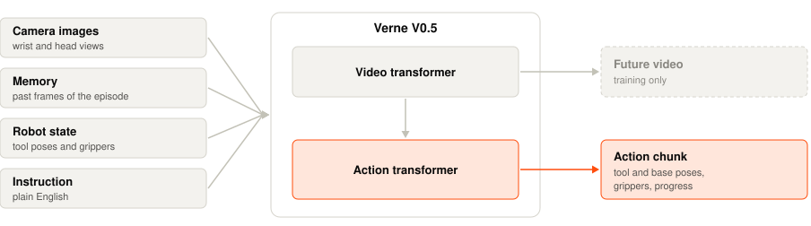
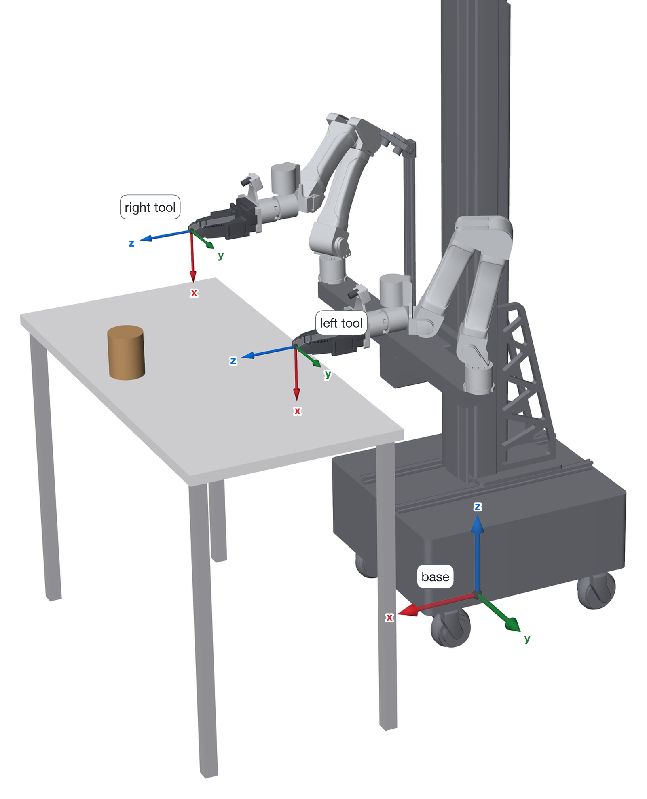
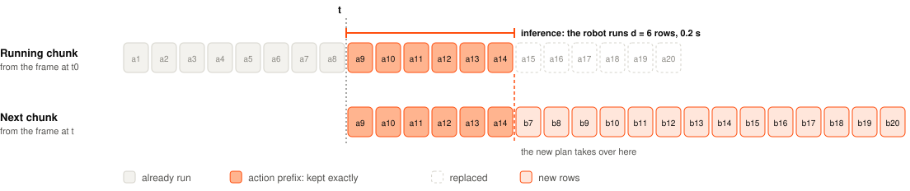

<p align="center">
  
</p>

<h1 align="center">Verne V0.5</h1>

<p align="center">An open-weight world action model for robots.</p>

<p align="center">
  <a href="https://vernerobotics.com">Website</a> ·
  <a href="https://huggingface.co/vernerobotics">Hugging Face</a> ·
  <a href="https://app.vernerobotics.com">Fine-tuning platform</a> ·
  <a href="https://huggingface.co/vernerobotics/v0.5-base">Model card</a> ·
  <a href="LICENSE">License</a>
</p>

Verne V0.5 is a world action model: one network that learns both how a scene changes and
how a robot should act in it. You give it three camera views, the robot's state and an
instruction in plain English. It keeps a memory of the episode so far, and it returns the
next 1.07 seconds of motion: 32 targets at 30 Hz for both end effectors, both grippers and
the mobile base.

This repository holds the model code, a loader for the weights on Hugging Face, and a
reference inference loop that you can run on your own robot or in simulation.

<picture>
  <source media="(prefers-color-scheme: dark)" srcset="assets/architecture-dark.svg">
  
</picture>

## Results

<picture>
  <source media="(prefers-color-scheme: dark)" srcset="assets/results-dark.svg">
  
</picture>

**RoboTwin 2.0**

| Model | Clean | Randomized |
|---|---|---|
| GO-3 Nano Preview | 88.5% | 81.5% |
| PICA-WAM | 90.7% | 74.7% |
| **Verne V0.5** | **81.0%** | **73.4%** |
| EWAM | 82.2% | 72.1% |
| ViGAR | 82.0% | 67.0% |
| UniWAM | 75.1% | 67.6% |
| π0.5 | 70.7% | 46.0% |
| π0 | 46.4% | 16.3% |

Selected from the [RoboTwin 2.0 leaderboard](https://robotwin-platform.github.io/leaderboard)
of October 30, 2026. π0 is a single-task result.
[Per-task results](https://huggingface.co/vernerobotics/v0.5-robotwin).

**LIBERO**

| Model | Average of 4 suites | Long |
|---|---|---|
| **Verne V0.5** | **99.3%** | **99.2%** |
| ABot-M0.5 | 99.4% | 98.4% |
| VPP2 | 98.8% | 98.0% |
| Cosmos Policy | 98.5% | 97.6% |
| X-VLA | 98.1% | 97.6% |
| Fast-WAM | 97.6% | 95.2% |
| π0.5 | 96.85% | 92.4% |
| π0 | 94.15% | 85.2% |

Other results as published. [Per-task results](https://huggingface.co/vernerobotics/v0.5-libero).

## Checkpoints

| Checkpoint | Use it for | Hugging Face |
|---|---|---|
| Base | Fine-tuning on your own robot and tasks | [vernerobotics/v0.5-base](https://huggingface.co/vernerobotics/v0.5-base) |
| LIBERO | The LIBERO benchmark | [vernerobotics/v0.5-libero](https://huggingface.co/vernerobotics/v0.5-libero) |
| RoboTwin 2.0 | The RoboTwin 2.0 benchmark | [vernerobotics/v0.5-robotwin](https://huggingface.co/vernerobotics/v0.5-robotwin) |

To fine-tune V0.5 on your own robot and tasks, you can sign up for the Verne fine-tuning
platform at [app.vernerobotics.com](https://app.vernerobotics.com).

## Install

Add V0.5 to a [uv](https://docs.astral.sh/uv/) project directly from GitHub:

```bash
uv add git+https://github.com/vernerobotics/v0.5
uv run hf auth login   # accept the license on the checkpoint page first
```

Outside a uv project, `uv pip install git+https://github.com/vernerobotics/v0.5` installs
V0.5 into the active virtual environment.

To change the code, clone the repository:

```bash
git clone https://github.com/vernerobotics/v0.5.git
cd v0.5
pip install -e .
hf auth login   # accept the license on the checkpoint page first
```

You need Linux, Python 3.10 or newer, an NVIDIA GPU with at least 24 GB, 32 GB of RAM and
35 GB of disk. The weights are 8.2B parameters in bf16 (17 GB). On a GPU with 40 GB or more,
pass `text_encoder_on_gpu=True`, so that a new instruction does not move the model to the
CPU and back.

## Run

```python
from verne import ArmState, Observation, Policy

policy = Policy.from_pretrained("vernerobotics/v0.5-base")
policy.reset()                                # at every episode start

obs = Observation(
    timestamp=t,                              # seconds
    instruction="Put the cup in the sink.",
    images={"camera_0": left_wrist, "camera_1": right_wrist, "camera_2": head},
    right=ArmState(right_pose, gripper=1.0),  # 4x4 tool pose in meters, 0 closed, 1 open
    left=ArmState(left_pose, gripper=1.0),    # None for a single-arm robot
    base_pose=base_pose,                      # optional: mobile base in odometry
)
policy.observe(obs)                           # every frame between plans, ideally at 30 Hz
chunk = policy.infer(next_obs)                # plan from a newer frame
chunk.right.pose                              # [32, 4, 4] targets, 1/30 s apart
chunk.right.gripper                           # [32]
chunk.base_pose                               # [32, 4, 4] base targets
chunk.progress                                # [32], 0 to 1: how much of the instruction is done
```

[`examples/quickstart.py`](examples/quickstart.py) runs this loop with made-up images. The
[LIBERO](examples/libero/README.md) and [RoboTwin 2.0](examples/robotwin/README.md)
examples run it in simulation. [`docs/interface.md`](docs/interface.md) is the full
reference for the inputs, the outputs, the memory and progress.

## Getting good results

**Fine-tune first.** The base checkpoint has not seen your robot, cameras or tasks. Record
teleoperated demonstrations and fine-tune before you deploy. We have seen good results on
zipper tasks and full-body pick and place with about 1 to 2 hours of data. Sign up for the
[Verne fine-tuning platform](https://app.vernerobotics.com) to fine-tune V0.5 on your data.

**Keep real-time action chunking on.** Pass the targets the robot runs during planning as
the prefix of the next call ([Real-time action chunking](#real-time-action-chunking)).
Without it, motion can jump between chunks. We plan every 0.6 s, in under 0.4 s.

**Check the frames.** Arm poses are in the robot base frame; the tool frame is in
[Output space](#output-space). A small step along tool +z must move the gripper forward.

**Use a differential IK.** V0.5 outputs end-effector and base poses, not joint angles. A
small QP per control tick works well, for example with
[mink](https://github.com/kevinzakka/mink):

- End-effector poses: frame tasks with high weight.
- Base pose: a softer task with base speed limits. Do not pin the base to the plan.
- Joint position and velocity limits as constraints, a weak posture task and some damping.
  A strong posture pull can flip the wrist.
- Warm-start from the measured joints and track `chunk.at(t)`. Do not reset the solver
  between chunks.

The RoboTwin 2.0 example includes a simple IK:
[`examples/robotwin/Verne/arm_ik.py`](examples/robotwin/Verne/arm_ik.py).

**Match the cameras.** Two wrist cameras and one fixed head camera that sees the whole
work area. Send full frames.

**Give one step at a time.** Split long tasks into short instructions and use
`chunk.progress` to move to the next one.

**Stream every frame.** Call `observe` at 30 Hz between plans and `infer` at least every
0.7 s. Call `reset()` at each episode start.

**Start slow.** Low speed and force limits, an emergency stop in reach, and a person
watching.

## Output space

<picture>
  <source media="(prefers-color-scheme: dark)" srcset="assets/output-space-dark.png">
  
</picture>

V0.5 acts in end-effector space. Each row of a chunk holds a tool pose and a jaw opening
(0 closed, 1 open) for each arm, a pose of the mobile base, and progress.

- Give arm poses in the robot base frame shown above: +x forward, +y left, +z up.
- On a mobile robot, give `base_pose` in a fixed frame such as odometry. V0.5 reads its
  x, y and yaw. All targets then come back in that fixed frame, the arm targets too. An
  arm target in the robot base frame is `inv(floor_pose(base)) @ target`, at the measured
  base pose.
- Without `base_pose`, the base targets are relative to the base pose now, and a fixed
  robot can ignore them.
- The tool frame has +z along the approach direction. With the gripper pointing forward
  and level, +x points down and +y points left.

## Real-time action chunking

The robot keeps moving while the model plans. Give the model the targets that the robot
runs during planning. The new chunk keeps them exactly and replaces the rest.

<picture>
  <source media="(prefers-color-scheme: dark)" srcset="assets/chunking-dark.svg">
  
</picture>

```python
d = 6                                            # ceil(planning time x 30), 1 to 12
prefix = chunk.at(t + np.arange(1, d + 1) / 30)  # the rows the robot runs while it plans
chunk = policy.infer(obs, prefix)                # first chunk: ActionChunk.hold(obs, d)
```

Planning must finish within 0.4 s (12 targets). If your controller changes the targets,
for example with speed limits, give the changed targets as the prefix.

## Inference speed

These are the main reasons inference is fast:

| | Where |
|---|---|
| The video transformer runs once per chunk. The 4 flow steps run only the action transformer on the cached video keys and values. No video is generated. | [`model/mot.py`](src/verne/model/mot.py) |
| Memory packs past frames into coarse patches. | [`model/memory.py`](src/verne/model/memory.py) |
| Each frame is VAE-encoded once and reused by later chunks. | [`memory_bank.py`](src/verne/memory_bank.py) |
| Each instruction is encoded once. | [`policy.py`](src/verne/policy.py) |
| The prompt keys and values are kept per instruction. The action context is projected once per chunk, not at each flow step. | [`model/wam.py`](src/verne/model/wam.py) |
| bf16, PyTorch SDPA attention, and optional `torch.compile` with one graph for every chunk. | [`model/wam.py`](src/verne/model/wam.py) |

## License

V0.5 is released under the [Verne V0.5 Model License](LICENSE). For commercial use, please
contact partnership@vernerobotics.com. We would love to work with you!

See [`THIRD_PARTY_NOTICES`](THIRD_PARTY_NOTICES) for third-party code and licenses.

## Citation

```bibtex
@misc{verne2026v05,
  title  = {Verne V0.5: An Open-Weight World Action Model to Accelerate Industrial Robot Deployments},
  author = {{Verne Team}},
  year   = {2026},
  url    = {https://vernerobotics.com}
}
```
