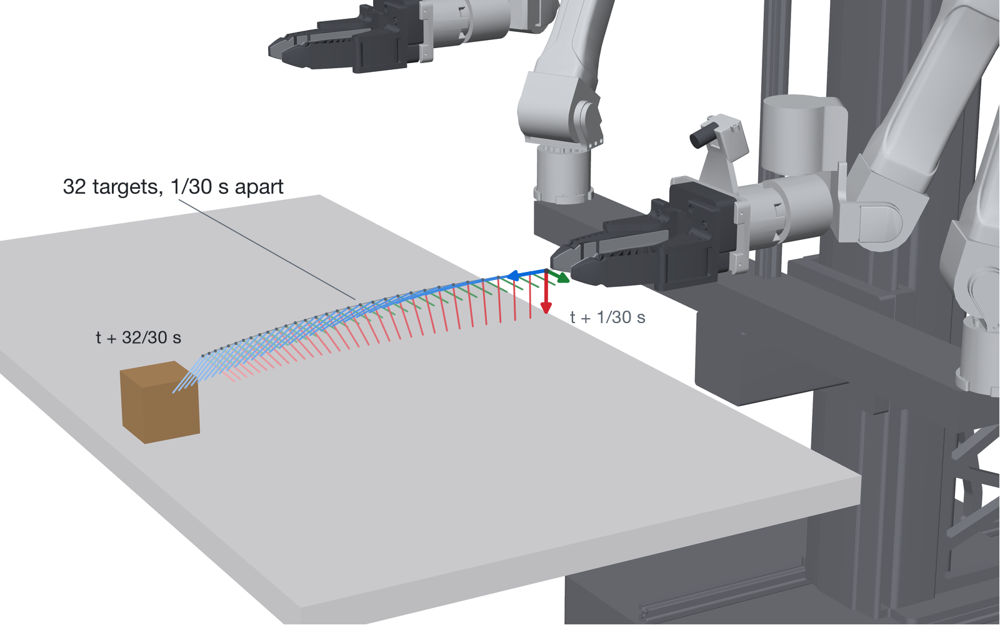
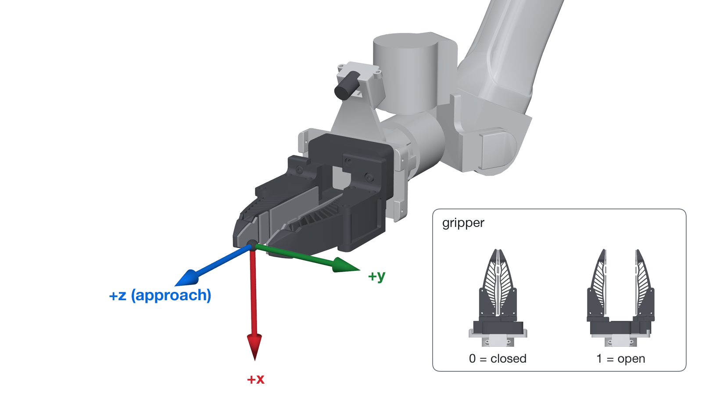

# Interface

The inputs, the outputs, the memory, real-time action chunking and the speed-ups of the
`verne` package. The code reference is
[`src/verne/interface.py`](../src/verne/interface.py).

## Inputs

`Policy.observe` and `Policy.infer` read an `Observation`. Each arm is an `ArmState`.

| Field | Format | Notes |
|---|---|---|
| `timestamp` | `float`, seconds | The capture time, on any clock that only increases. |
| `instruction` | `str` | The task in plain English. A prompt that fills all the text tokens of the checkpoint raises an error. |
| `images` | `camera_0` left wrist, `camera_1` right wrist, `camera_2` head; uint8 RGB `[H, W, 3]`, any size | Each image is stretched to 256 x 256, so give the full field of view. The head camera is fixed and sees the whole work area. It is centre-cropped to 87.5%. A missing camera is a black image. |
| `right`, `left` | `ArmState(pose, gripper)` | The tool pose as a `[4, 4]` homogeneous transform, in meters. The jaw opening from 0.0 (closed) to 1.0 (open). `left=None` for a single-arm robot. |
| `base_pose` | `[4, 4]`, optional | A mobile robot: the pose of the robot base frame in a fixed frame, such as odometry, +x forward, +y left, +z up. V0.5 reads its x, y and yaw. |

- Each type checks its values when you make it: shapes, finite values, uint8 images, and
  rigid poses (bottom row `[0, 0, 0, 1]`, an orthonormal rotation, no flipped axis). A bad
  value raises an error that tells you what to fix.
- Give each observation once: to `observe` or to `infer`, not to both. A repeated
  timestamp raises an error.
- Timestamps are in seconds. A gap of more than 0.93 s between two observations raises an
  error. Call `reset()` when the robot resumes after a pause.
- Give the same arms, and a base pose or none, in every observation of an episode.
- Give the tool pose the way the training data recorded it. For the base and RoboTwin 2.0
  checkpoints, this is the measured pose. The LIBERO checkpoint reads the controller goal,
  as the LIBERO example shows.
- Single-arm robots: give `right` and `camera_1`, with `left=None` and no `camera_0`. The
  model reads a parked left arm and a black left wrist camera.
- `policy.encode_instructions([...])` encodes the instructions of a task before the
  episode, so `infer` does not wait for the text encoder. `infer` encodes a new
  instruction once, on its first chunk.

## Threads

- A `Policy` is safe to share between threads. `observe` holds a short lock on the
  history, so a camera thread can call it while a planner thread runs `infer`.
- `infer`, `reset` and `encode_instructions` run one at a time.
- Timestamps must still rise across the threads. Give each frame to `observe` or to
  `infer`, in time order.

## Outputs

`infer` returns an `ActionChunk` of 32 rows at 30 Hz. Row `j` is the target for time
`obs.timestamp + (j + 1) / 30`.

<picture>
  <source media="(prefers-color-scheme: dark)" srcset="../assets/action-chunk-dark.png">
  
</picture>

| Field | Shape | Meaning |
|---|---|---|
| `left.pose`, `right.pose` | float64 `[32, 4, 4]` | Target tool poses. With a base input, in its fixed frame. Without one, in the robot base frame. |
| `left.gripper`, `right.gripper` | float32 `[32]` | Target jaw opening, 0.0 closed to 1.0 open |
| `base_pose` | float64 `[32, 4, 4]` | Target base poses on the floor (x, y and yaw). With a base input, in its fixed frame. Without one, relative to the base pose now. |
| `progress` | float32 `[32]` | How much of the current instruction is done, 0 to 1 |
| `timestamps` | float64 `[32]` | The target time of each row, in seconds |

`left` is None for a single-arm robot. `chunk.at(times)` returns the chunk at other times,
with linear interpolation between rows. Use it for the target of one control tick, or for
the prefix of the next chunk.

### Frames

- **Robot frame.** Give both arm poses in the robot base frame. On a robot with a lift,
  include the lift in the arm pose. Both arms must use the same frame: the model reads the
  pose of one tool relative to the other. The model reads and predicts arm motion relative
  to the current tool frames.
- **Fixed frame.** On a mobile robot, give `base_pose` in a fixed frame such as odometry.
  The model trained on tool poses in that fixed frame, so `Policy` reads each tool at
  `floor_pose(base_pose) @ arm pose`. `floor_pose` (in `verne.geometry`) keeps x, y and
  yaw, and sets z, roll and pitch to 0. The arm targets, the base targets and the prefix
  are all in the fixed frame. To command an arm in the robot base frame, use
  `inv(floor_pose(base)) @ target`, with the base pose measured when the arm runs the
  target.
- **No base input.** The arm targets are in the robot base frame. The base targets are
  relative to the base pose now, and a prefix holds the base still. Give `base_pose`
  whenever the base can move: in the training data, tool poses stay in the fixed frame
  while the base drives.
- **Tool frame.** +z points out of the gripper, along the approach direction. When the
  gripper points forward and level, +x points down and +y points left. The origin is a
  fixed point on the gripper, for example the centre between the fingertips.
- The examples convert simulator frames to this convention with `TOOL_AXES`:
  [`examples/libero/main.py`](../examples/libero/main.py),
  [`examples/robotwin/Verne/model.py`](../examples/robotwin/Verne/model.py).

<picture>
  <source media="(prefers-color-scheme: dark)" srcset="../assets/tool-frame-dark.png">
  
</picture>

### Model rows

Inside the model a row has 30 values: for each arm a 9-value pose (position, then the first
two rows of the rotation matrix) and a gripper value, then a 9-value base pose, then
progress. Arm poses are relative to the current tool pose of the same arm, and the base
pose is relative to the current base pose. The robot state input is relative too: each
arm's pose 1/30 s ago in its current tool frame, and the right tool pose in the left tool
frame. `Policy` converts to and from absolute 4 x 4 poses.

## Memory

- Each `observe` or `infer` call adds the frame to a 30 Hz history. Every 133 ms, one frame
  is encoded by the VAE and stored. A stored frame is used again by later chunks.
- Each `infer` call reads 16 stored frames, 1.07 s apart: the last 17 s of the episode.
- Recent frames keep fine detail. Older frames are packed into coarse patches. The 16
  frames take 168 tokens; one full frame takes 192.
- Empty slots at the start of an episode are marked as padding.
- `policy.reset()` clears the memory.
- Call `infer` at least every 0.7 s. A longer gap leaves holes in the memory.
- Without `Policy`, pass `past_latents` and `past_padded` to
  `WorldActionModel.infer_action`, or `None` to plan with an empty memory.

Code: [`memory_bank.py`](../src/verne/memory_bank.py),
[`model/memory.py`](../src/verne/model/memory.py).

## Progress

- The model's estimate of how much of the current instruction is done, from 0 to 1. It is
  trained on step-by-step instructions, so it measures the current step.
- Use it to decide when to send the next instruction of a multi-step task.
- It is an output only. The model never reads progress as input.
- With an action prefix, the first rows of `progress` return the prefix values. Read
  progress from the rows after the prefix.
- It is an estimate, not a success check. Test it on your task before you act on it.

## Real-time action chunking

- `d` is the number of 1/30 s targets the robot runs while the model plans:
  `ceil(planning time x 30)`.
- The model was trained with prefixes of 0 to 12 targets, so planning must finish within
  0.4 s.
- Take the prefix from the running chunk: `chunk.at(obs.timestamp + np.arange(1, d + 1) / 30)`.
  Row `j` must be at `obs.timestamp + (j + 1) / 30`, within 1 ms.
- Give the targets that the controller really runs. If the controller changes them, for
  example with speed limits, give the changed targets.
- The prefix rows stay fixed through every flow step (`WorldActionModel.infer_action` in
  [`model/wam.py`](../src/verne/model/wam.py)). The output returns them unchanged.
- With a base input, the prefix carries the base targets. Without one, the base holds
  still in the prefix.
- The robot holds still while the first chunk of an episode is planned. Give that as the
  prefix: `ActionChunk.hold(obs, d)` repeats the current poses and grippers `d` times.
- `infer` checks the observation and the prefix before it changes the policy. A call that
  raises leaves the policy as it was, so you can retry with fixed inputs.
- `reset(seed=...)` sets the sampling noise. The default seed is 0.

## Inference speed

| What | Where | Effect |
|---|---|---|
| The video transformer runs once per chunk. The 4 flow steps run only the action transformer, which reads the cached video keys and values. No future video is generated. | `run_video_blocks`, `run_action_blocks` in [`model/mot.py`](../src/verne/model/mot.py) | The large transformer runs once per chunk, not 4 times. |
| The last video block that the action transformer reads computes only its keys and values. | `KeyValueBlock` in [`model/wan_dit.py`](../src/verne/model/wan_dit.py) | Skips that block's attention output, cross-attention and FFN. |
| Memory packs older frames into coarse patches. | `pack_slots`, `PastFrameMemory` in [`model/memory.py`](../src/verne/model/memory.py) | 168 tokens for 16 past frames, not 3,072. |
| The VAE encodes each memory frame once, on a 133 ms grid. | `MemoryBank.read` in [`memory_bank.py`](../src/verne/memory_bank.py) | About 5 new frame encodes per chunk at a 0.6 s period, not 17. They run in `infer`, before planning. |
| Camera images are resized only for the frames that a canvas reads: the present frame and the memory ticks. | `CameraFrames` in [`transforms.py`](../src/verne/transforms.py) | About 6 of the 18 frames of a 0.6 s chunk period at 30 Hz. |
| Each instruction is encoded once and kept. `encode_instructions` encodes them before the episode. | `Policy._text` in [`policy.py`](../src/verne/policy.py) | The text encoder runs only for a new instruction. |
| The text encoder waits on the CPU and moves to the GPU only to encode. | `Policy._encode_prompts` in [`policy.py`](../src/verne/policy.py) | Keeps about 11 GB off the GPU. `text_encoder_on_gpu=True` skips the move. |
| The video transformer keeps the keys and values of the instruction text. Each chunk projects only the robot state row. | `WorldActionModel._prompt_cache` in [`model/wam.py`](../src/verne/model/wam.py) | About 0.76 TFLOP less per chunk. |
| The action transformer projects its context keys and values once per chunk, not at each flow step. | `project_context` in [`model/mot.py`](../src/verne/model/mot.py) | About 0.22 TFLOP less per chunk. |
| RoPE tables, masks, the zero-time modulation and the sigma schedule are built once per shape and stay on the GPU. | `_grid_constants`, `_step_constants` in [`model/wam.py`](../src/verne/model/wam.py) | No copies of constants to the GPU in a chunk. About 1,100 fewer small ops per chunk. |
| bf16 weights and PyTorch scaled dot-product attention. The action cross-attention gets no mask. | `attention` in [`model/wan_dit.py`](../src/verne/model/wan_dit.py) | PyTorch can use its flash kernel for the cross-attention. The self-attention needs its mask. |
| Optional `torch.compile` of the context projection, the video pass and the action step. | `WorldActionModel.enable_compile` in [`model/wam.py`](../src/verne/model/wam.py) | The first chunk compiles. Chunks with and without a prefix share one action-step graph, so no later chunk compiles. The VAE stays eager. |
